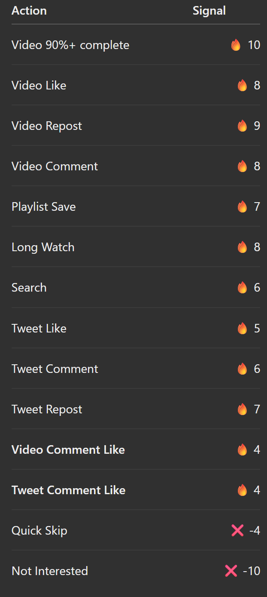

# Powerfull recomedation designe base v1 

                                      USER
                                        │
                                        ↓
                               USER BEHAVIOR
                                        │
             ┌──────────────────────────┼──────────────────────────┐
             ↓                          ↓                          ↓
          VIDEOS                      TWEETS                    SEARCH
             │                          │                          │
      ┌──────┼──────┐             ┌─────┼─────┐                   │
      ↓      ↓      ↓             ↓     ↓     ↓                   ↓
    Watch   Like   Repost       Like  Comment Repost             Query
      │      │      │             │     │     │                   │
      ↓      ↓      ↓             ↓     ↓     ↓                   ↓
  Duration   │      │             │     │     │              Search Topic
  Complete   │      │             │     │     │                   │
      │      │      │             │     │     │                   │
      └──────┴──────┴─────────────┴─────┴─────┘                   │
                         │                                         │
                         └─────────────────────────────────────────┘
                                           │
                                           ↓
                                  USER INTEREST PROFILE
                                           │
                    ┌──────────────────────┼──────────────────────┐
                    ↓                      ↓                      ↓
                  TOPICS                CREATORS                CONTENT
                    │                      │                      │
                    │                      │                      │
             ┌──────┼──────┐        ┌─────┴─────┐         ┌──────┴──────┐
             ↓      ↓      ↓        ↓           ↓         ↓             ↓
           Strong  Medium  Weak   Subscribed  Followed   Similar       New
          Interest Interest Interest Creators   Users    Content      Content
                    │                      │                      │
                    └──────────────────────┼──────────────────────┘
                                           ↓
                              ML FEATURE GENERATION
                                           │
             ┌─────────────────────────────┼─────────────────────────────┐
             ↓                             ↓                             ↓
      POSITIVE SIGNALS              NEGATIVE SIGNALS                CONTEXT
             │                             │                             │
             ↓                             ↓                             ↓
       Watch Percentage               Skip Video                    Recency
       Completion                     Not Interested                Language
       Like                           Quick Exit                    Time
       Comment                        Unfollow                      Session
       Repost                         Repeated Skip                 Device
       Playlist Save
       Tweet Engagement
       Search Interest
       Creator Subscription
             │                             │                             │
             └─────────────────────────────┼─────────────────────────────┘
                                           ↓
                                ML RECOMMENDATION MODEL
                                           │
                                           ↓
                               PERSONALIZED SCORE
                                           │
                                           ↓
                                CANDIDATE VIDEOS
                                           │
             ┌─────────────────────────────┼─────────────────────────────┐
             ↓                             ↓                             ↓
      STRONG INTEREST                SUBSCRIBED                      EXPLORATION
          VIDEOS                     CREATORS                          │
             │                             │                            │
             ↓                             ↓                            ↓
       Related Topics              Related Videos               New Topics
       Related Content             Only Relevant                 Similar Topics
       High Engagement             Content                       New Creators
             │                             │                            │
             └─────────────────────────────┼─────────────────────────────┘
                                           ↓
                                  TRENDING CONTENT
                                           │
                                           ↓
                                  CANDIDATE MERGE
                                           │
                                           ↓
                                REMOVE DUPLICATES
                                           │
                                           ↓
                              APPLY NEGATIVE SIGNALS
                                           │
                                           ↓
                                  FINAL RANKING
                                           │
                                           ↓
                              DIVERSITY / MIXING
                                           │
                    ┌──────────────────────┼──────────────────────┐
                    ↓                      ↓                      ↓
                  70%                    15%                    10%
             STRONG INTEREST       SUBSCRIBED CREATORS      SIMILAR / NEW
                    │                      │                      │
                    └──────────────────────┼──────────────────────┘
                                           │
                                           ↓
                                      5% EXPLORATION
                                           │
                                           ↓
                                  FINAL HOME FEED
                                           │
                                           ↓
                                      PAGINATION
                                           │
                                           ↓
                                      USER FEED

## user

USER
 │
 ├── Topics
 │    ├── React        → 0.94
 │    ├── Node.js      → 0.88
 │    ├── MongoDB      → 0.76
 │    └── Python       → 0.31
 │
 ├── Creators
 │    ├── Creator A    → 0.91
 │    └── Creator B    → 0.67
 │
 ├── Content Type
 │    ├── Tutorials
 │    ├── Projects
 │    └── Programming
 │
 └── Behavior
      ├── Completion
      ├── Likes
      ├── Comments
      ├── Reposts
      └── Saves

---

# Updated user behaviour
 
USER
  ↓
USER BEHAVIOR
  │
  ├───────────────────────┬───────────────────────┬───────────────────┐
  ↓                       ↓                       ↓
VIDEOS                  TWEETS                  SEARCH
  │                       │                       │
  ├── Watch               ├── Like                └── Query
  ├── Watch Duration      ├── Comment
  ├── Completion          ├── Repost
  ├── Like                └── Comment Like
  ├── Comment
  ├── Repost
  ├── Playlist Save
  └── Comment Like

---

## comment -> video recomedation

COMMENT BEHAVIOR
       ↓
 ┌─────┴───────────┐
 ↓                 ↓
Comment          Like Comment
 ↓                 ↓
Video/Tweet       Video/Tweet
 ↓                 ↓
Comment Topic     Comment Topic
       \           /
        \         /
         ↓       ↓
       USER INTEREST

---

## comment logic

Video A
   ↓
Comment:
"Best React state management tutorial"
   ↓
User ❤️ Comment
   ↓
Extract comment topic
   ↓
React / State Management
   ↓
Find related videos
   ↓
Recommendation score ↑

# tweet -> video recomedatio 

User searches:
"React Server Components"

        ↓

React related Tweet

        ↓

User Likes Tweet
        +
User Comments on Tweet

        ↓

Interest Score ↑

        ↓

React Server Components videos
        ↓
Recommendation Score ↑

## subcriber logic
 User subscribed to Creator A

Creator A:
React Tutorial       ✅
Node.js Tutorial     ✅
MongoDB Tutorial     ✅
Cooking Video        ❌
Gaming Video         ❌

## negative signal 

Video
 ↓
User opens
 ↓
3 seconds mein exit

---

# final remcondation 
USER
 ↓
Collect behavior
 ↓
Build user interest profile
 ↓
Generate ML features
 ↓
Generate candidate videos
 ↓
Calculate recommendation score
 ↓
Remove:
 ├── duplicates
 ├── deleted videos
 ├── unpublished videos
 └── unwanted/negative content
 ↓
Apply:
 ├── 70% strong interests
 ├── 15% subscribed creators
 ├── 10% similar/new topics
 └── 5% exploration
 ↓
Diversity check
 ↓
Final ranking
 ↓
Pagination
 ↓
getHomeFeed()

---

Ml Architecture

controllers/
    home.controller.js
        ↓
services/
    recommendation.service.js
        ↓
ml/
    recommendationModel
        ↓
features/
    userFeatures
    videoFeatures
        ↓
MongoDB

## then

getHomeFeed
      ↓
recommendationService
      ↓
ML model
      ↓
ranked video IDs
      ↓
Video.aggregate()
      ↓
final response

---

# Weightage for final recommendation

----

# FInal recommendation score calculation

                                      USER
                                        ↓
                                USER BEHAVIOR
                                        ↓
       ┌───────────────────────┬────────┼────────┬───────────────────────┐
       ↓                       ↓        ↓        ↓                       ↓
    VIDEOS                   TWEETS   SEARCH   COMMENTS              PLAYLIST
       │                       │        │        │                       │
       ├─ Watch                ├─ Like  └─Query  ├─ Comment              └─ Save
       ├─ Duration             ├─Comment         ├─ Like Comment
       ├─ Completion           ├─Repost          ├─ Video Comment
       ├─ Like                 └─Comment Like    └─ Tweet Comment
       ├─ Repost
       └─ Playlist
                                        ↓
                              COMMENT / CONTENT TOPICS
                                        ↓
                            ┌───────────┴───────────┐
                            ↓                       ↓
                         Topics                  Creators
                            ↓                       ↓
                            └───────────┬───────────┘
                                        ↓
                               USER INTEREST PROFILE
                                        ↓
                               ML FEATURE GENERATION
                                        ↓
                    ┌───────────────────┼───────────────────┐
                    ↓                   ↓                   ↓
               POSITIVE             NEGATIVE             CONTEXT
               SIGNALS              SIGNALS             SIGNALS
                    ↓                   ↓                   ↓
             Watch/Complete           Skip              Recency
             Like                    Not Interested      Language
             Repost                  Unfollow            Time
             Comment                 Quick Exit          Session
             Playlist Save
             Search
             Tweet Engagement
             Comment Like
             Subscription
                    └───────────────────┼───────────────────┘
                                        ↓
                              ML RECOMMENDATION MODEL
                                        ↓
                               PERSONALIZED SCORE
                                        ↓
                              CANDIDATE VIDEOS
                                        ↓
              ┌─────────────────────────┼─────────────────────────┐
              ↓                         ↓                         ↓
       STRONG INTEREST          SUBSCRIBED CREATORS          SIMILAR CONTENT
              ↓                         ↓                         ↓
       Related Topics            Relevant videos            New topics
       Related Comments          Only related content       Similar users
       Search Interest            New relevant videos        Similar videos
              └─────────────────────────┼─────────────────────────┘
                                        ↓
                                 TRENDING CONTENT
                                        ↓
                                REMOVE DUPLICATES
                                        ↓
                              APPLY NEGATIVE SIGNALS
                                        ↓
                              APPLY DIVERSITY RULES
                                        ↓
                                    RANKING
                                        ↓
                         ┌──────────────┼──────────────┐
                         ↓              ↓              ↓
                       70%            15%            10%
                    INTEREST      SUBSCRIBED      SIMILAR/NEW
                         └──────────────┼──────────────┘
                                        ↓
                                  5% EXPLORATION
                                        ↓
                                  FINAL FEED
                                        ↓
                                   PAGINATION
                                        ↓
                                  HOME FEED