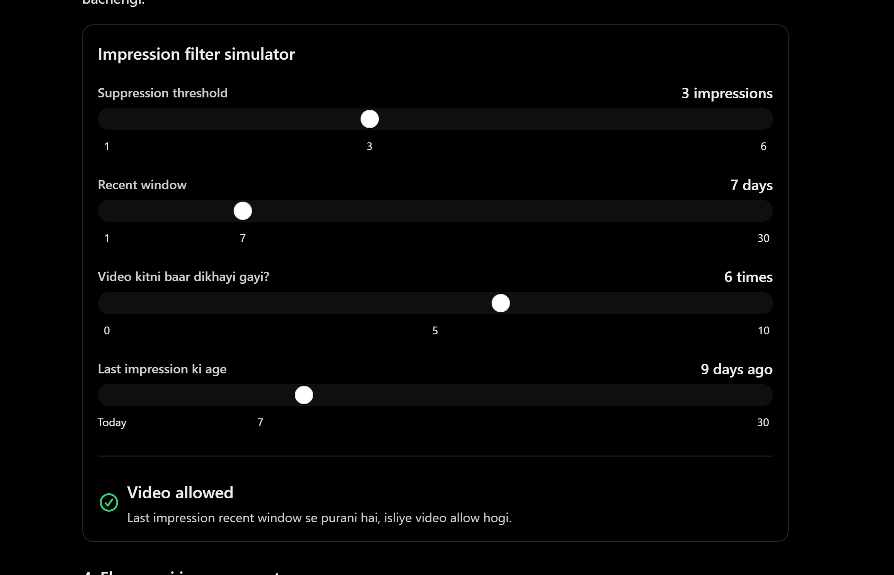

# video feed for each user 

User activity
    ↓
Liked videos
Reposted videos
Watched videos
Playlists
    ↓
Interested content/owners identify
    ↓
Relevant videos find
    ↓
Popular + recent videos mix
    ↓
Duplicate remove
    ↓
Rank
    ↓
Home Feed


# CODE

```JSX
import mongoose from "mongoose";

import { Video } from "../models/video.models.js";
import FeedImpression from "../models/FeedImpression.model.js";

import {
    builtUserIntrestProfile,
    calculateInterestScore
} from "./recommendation.service.js";

import { asyncHandler } from "../utils/asynchandler.js";
import { ApiResponse } from "../utils/ApiResponse.js";


// ============================================================
// STEP 1: FEED SETTINGS
// ============================================================

// Har batch mein approximately 80% personalized videos hongi.
// Example: limit 10 hai toh target 8 personalized + 2 popular.
const PERSONALIZED_RATIO = 0.8;

// Ek request mein maximum 50 videos return karenge.
// Isse client aur database dono par unnecessary load nahi padega.
const MAX_FEED_LIMIT = 50;

// Personalized ranking ke liye latest 500 eligible videos check karenge.
// Ye candidate limit hai, poori database ki total video count nahi.
const VIDEO_CANDIDATE_LIMIT = 500;

// Popular videos ke liye sirf pichhle 3 calendar months eligible honge.
const POPULAR_VIDEO_MONTHS = 3;

// Pichhle 7 din mein dikhayi gayi videos ko recently shown maana jayega.
const RECENT_IMPRESSION_DAYS = 7;

// Ek hi video 7 din ke andar 3 ya usse zyada baar dikh chuki hai,
// toh filhaal usse suppress karenge.
// Ye dislike nahi hai; sirf repeated exposure ko control karta hai.
const MAX_RECENT_IMPRESSIONS = 3;


// ============================================================
// STEP 2: DATE HELPERS
// ============================================================

// Current date se pichhle 3 calendar months ka cutoff nikaalte hain.
// setMonth() calendar months use karta hai, fixed 90 days nahi.
function getPopularCutoffDate() {
    const cutoffDate = new Date();

    cutoffDate.setMonth(
        cutoffDate.getMonth() - POPULAR_VIDEO_MONTHS
    );

    return cutoffDate;
}


// Current date se 7 din pehle ka cutoff nikaalte hain.
// Isse recently shown videos identify kar sakte hain.
function getRecentImpressionCutoffDate() {
    const cutoffDate = new Date();

    cutoffDate.setDate(
        cutoffDate.getDate() - RECENT_IMPRESSION_DAYS
    );

    return cutoffDate;
}


// ============================================================
// STEP 3: DUPLICATE VIDEOS REMOVE KARNA
// ============================================================

function removeDuplicateVideos(videos) {

    // Har unique video ID ko ek hi baar accept karenge.
    const seenIds = new Set();

    return videos.filter((video) => {

        // ObjectId ko string mein convert karne se comparison easy hota hai.
        const videoId = String(video._id);

        // Agar video pehle mil chuki hai, toh duplicate remove kar do.
        if (seenIds.has(videoId)) {
            return false;
        }

        // Is video ko seen mark kar do.
        seenIds.add(videoId);

        // Pehli baar mili hai, isliye list mein rakho.
        return true;
    });
}


// ============================================================
// STEP 4: IMPRESSION FILTERING
// ============================================================



function filterRecentlyShownVideos(videos, impressionMap) {

    return videos.filter((video) => {

        // Current video ki impression summary find karte hain.
        const impression = impressionMap.get(
            String(video._id)
        );

        // Agar impression record nahi hai, toh video pehle tracked nahi hui.
        if (!impression) {
            return true;
        }

        // Last time video kab dikhayi gayi thi.
        const lastShownAt = new Date(impression.lastShownAt);

        // Sirf recent impression window ke records ko consider karenge.
        const isRecentlyShown =
            lastShownAt >= getRecentImpressionCutoffDate();

        // Purani impression ho toh video dobara eligible ho sakti hai.
        if (!isRecentlyShown) {
            return true;
        }

        // Recent window mein repeated exposure threshold cross hua?
        const hasRepeatedExposure =
            impression.impressionCount >= MAX_RECENT_IMPRESSIONS;

        // Repeatedly shown videos ko temporarily suppress karenge.
        // Baaki recent videos feed mein aa sakti hain.
        if (hasRepeatedExposure) {
            return false;
        }

        return true;
    });
}


// ============================================================
// STEP 5: MIX PERSONALIZED + POPULAR VIDEOS
// ============================================================

function buildMixedFeed(
    personalizedVideos,
    popularVideos,
    limit,
    personalizedRatio = PERSONALIZED_RATIO
) {

    // Desired number of personalized videos per batch.
    const personalizedLimit = Math.round(
        limit * personalizedRatio
    );

    // Baaki jagah popular videos ke liye target hogi.
    const popularLimit = limit - personalizedLimit;

    // Final ordered feed isi array mein banegi.
    const feed = [];

    // Dono lists ki current positions track karenge.
    let personalizedIndex = 0;
    let popularIndex = 0;

    // Jab tak kisi bhi source mein videos available hain, batches banayenge.
    while (
        personalizedIndex < personalizedVideos.length ||
        popularIndex < popularVideos.length
    ) {

        // Har batch mein maximum `limit` videos hongi.
        const batch = [];

        // --------------------------------------------------------
        // STEP 5A: Personalized videos ko pehle priority do
        // --------------------------------------------------------

        while (
            batch.length < personalizedLimit &&
            personalizedIndex < personalizedVideos.length
        ) {
            batch.push(
                personalizedVideos[personalizedIndex]
            );

            personalizedIndex++;
        }

        // --------------------------------------------------------
        // STEP 5B: Popular videos ka quota fill karo
        // --------------------------------------------------------

        while (
            batch.length < personalizedLimit + popularLimit &&
            popularIndex < popularVideos.length
        ) {
            batch.push(
                popularVideos[popularIndex]
            );

            popularIndex++;
        }

        // --------------------------------------------------------
        // STEP 5C: Agar target quota available nahi hai toh fallback
        // --------------------------------------------------------

        // Agar personalized videos kam hain, toh available popular videos
        // se batch ko fill karenge.
        //
        // Agar popular videos kam hain, toh remaining personalized videos
        // ko priority denge.
        while (batch.length < limit) {

            if (
                personalizedIndex < personalizedVideos.length
            ) {
                batch.push(
                    personalizedVideos[personalizedIndex]
                );

                personalizedIndex++;

            } else if (
                popularIndex < popularVideos.length
            ) {
                batch.push(
                    popularVideos[popularIndex]
                );

                popularIndex++;

            } else {
                // Dono lists khatam ho gayi hain.
                break;
            }
        }

        // Agar batch empty hai toh loop stop kar do.
        if (batch.length === 0) {
            break;
        }

        // Batch ko final feed mein add kar do.
        feed.push(...batch);
    }

    return feed;
}


// ============================================================
// STEP 6: VIDEO HOME FEED
// ============================================================

export const getVideoHomeFeed = asyncHandler(
    async (req, res) => {

        // --------------------------------------------------------
        // STEP 6A: User aur pagination values
        // --------------------------------------------------------

        // Ye endpoint authenticated user ke liye hai.
        const userId = req.user._id;

        // Page missing ya invalid ho toh page 1 use karo.
        const page = Math.max(
            1,
            Number.parseInt(req.query.page, 10) || 1
        );

        // Default 10 videos return karenge.
        // Limit ko minimum 1 aur maximum 50 ke beech rakhenge.
        const limit = Math.min(
            MAX_FEED_LIMIT,
            Math.max(
                1,
                Number.parseInt(req.query.limit, 10) || 10
            )
        );

        // --------------------------------------------------------
        // STEP 6B: User ka interest profile lao
        // --------------------------------------------------------

        // Existing recommendation service se interests aur popular videos
        // milenge. User ke interests dobara calculate nahi kar rahe.
        const userProfile = await builtUserIntrestProfile(userId);

        // Video-related interests se video relevance score calculate hoga.
        const videoInterests = userProfile.videoInterests;

        // Recommendation service ke existing popular candidates reuse karenge.
        const profilePopularVideos =
            userProfile.popularVideos || [];

        // --------------------------------------------------------
        // STEP 6C: Recent impression records fetch karo
        // --------------------------------------------------------

        // Sirf current user ki video impressions chahiye.
        // Tweets aur creator impressions ko is video feed mein use nahi karna.
        const impressionRecords = await FeedImpression.find({
            user: userId,
            contentType: "video"
        })
            .select(
                "contentId lastShownAt impressionCount"
            )
            .lean();

        // Impression records ko Map mein convert karenge,
        // taaki har candidate ki impression lookup fast ho.
        const impressionMap = new Map();

        for (const impression of impressionRecords) {

            impressionMap.set(
                String(impression.contentId),
                impression
            );
        }

        // --------------------------------------------------------
        // STEP 6D: Eligible video candidates database se lao
        // --------------------------------------------------------

        // Deleted aur unpublished videos ko feed mein nahi dikhayenge.
        // Latest candidates ko pehle laayenge.
        const candidateVideos = await Video.aggregate([
            {
                $match: {
                    isDeleted: false,
                    isPublished: true
                }
            },

            // Newest videos ko candidate pool mein priority milegi.
            {
                $sort: {
                    createdAt: -1
                }
            },

            // Performance ke liye candidate pool limit kar rahe hain.
            {
                $limit: VIDEO_CANDIDATE_LIMIT
            },

            // Sirf feed ke liye required fields return karenge.
            {
                $project: {
                    title: 1,
                    description: 1,
                    category: 1,
                    tags: 1,
                    thumbnail: 1,
                    createdAt: 1,
                    owner: 1,
                    viewCount: 1
                }
            }
        ]);

        // --------------------------------------------------------
        // STEP 6E: Personalized videos ka score calculate karo
        // --------------------------------------------------------

        // Har candidate ke title, description, category aur tags ko
        // existing interest scoring function ke against check karenge.
        const scoredVideos = candidateVideos.map((video) => {

            const videoText = [
                video.title,
                video.description,
                video.category,
                ...(video.tags || [])
            ]
                .filter(Boolean)
                .join(" ");

            // Existing recommendation service ka function reuse ho raha hai.
            const interestScore = calculateInterestScore(
                videoText,
                videoInterests
            );

            // Original video object ke saath score attach karenge.
            return {
                ...video,
                interestScore
            };
        });

        // --------------------------------------------------------
        // STEP 6F: Personalized candidates ko rank karo
        // --------------------------------------------------------

        // Higher interest score wali videos pehle aayengi.
        // Equal scores par newer video ko priority denge.
        scoredVideos.sort((videoA, videoB) => {

            if (videoB.interestScore !== videoA.interestScore) {
                return videoB.interestScore - videoA.interestScore;
            }

            return (
                new Date(videoB.createdAt) -
                new Date(videoA.createdAt)
            );
        });

        // Personalized feed mein zero-score videos ko nahi rakhenge.
        // Unhe fallback ya popular source se aane ka mauka mil sakta hai.
        const personalizedCandidates = scoredVideos.filter(
            (video) => video.interestScore > 0
        );

        // --------------------------------------------------------
        // STEP 6G: Popular videos par 3-month cutoff lagao
        // --------------------------------------------------------

        // Popular candidates ko recent calendar-month cutoff ke against check karo.
        const popularCutoffDate = getPopularCutoffDate();

        const recentPopularCandidates = profilePopularVideos.filter(
            (video) => {

                // Missing createdAt wali video ko popular source se reject karo.
                if (!video.createdAt) {
                    return false;
                }

                // Sirf cutoff ke baad publish hui videos popular feed mein eligible hain.
                return (
                    new Date(video.createdAt) >= popularCutoffDate
                );
            }
        );

        // --------------------------------------------------------
        // STEP 6H: Dono lists se duplicates remove karo
        // --------------------------------------------------------

        const uniquePersonalizedVideos = removeDuplicateVideos(
            personalizedCandidates
        );

        const uniquePopularVideos = removeDuplicateVideos(
            recentPopularCandidates
        );

        // Personalized IDs ko Set mein store karenge.
        const personalizedIds = new Set(
            uniquePersonalizedVideos.map(
                (video) => String(video._id)
            )
        );

        // Popular list se woh videos remove karo jo personalized list mein hain.
        const nonDuplicatePopularVideos = uniquePopularVideos.filter(
            (video) => !personalizedIds.has(String(video._id))
        );

        // --------------------------------------------------------
        // STEP 6I: Recent repeated impressions filter karo
        // --------------------------------------------------------

        // Repeatedly shown videos ko personalized aur popular dono sources
        // se filter karna zaroori hai, warna duplicate exposure wapas aa sakta hai.
        const filteredPersonalizedVideos = filterRecentlyShownVideos(
            uniquePersonalizedVideos,
            impressionMap
        );

        const filteredPopularVideos = filterRecentlyShownVideos(
            nonDuplicatePopularVideos,
            impressionMap
        );

        // --------------------------------------------------------
        // STEP 6J: Latest-video fallback list banao
        // --------------------------------------------------------

        // Agar personalized aur popular candidates kam pad jaayein,
        // toh latest published videos se feed ko fill karenge.
        //
        // Ye fallback videos popular nahi maani jaayengi.
        const usedVideoIds = new Set([
            ...filteredPersonalizedVideos.map(
                (video) => String(video._id)
            ),
            ...filteredPopularVideos.map(
                (video) => String(video._id)
            )
        ]);

        // Candidate list pehle se newest-first sorted hai.
        const fallbackCandidates = candidateVideos.filter(
            (video) => {

                const videoId = String(video._id);

                // Jo videos already kisi source mein hain, unhe dobara nahi lena.
                if (usedVideoIds.has(videoId)) {
                    return false;
                }

                // Fallback videos par bhi repeated impression filter apply hoga.

                // ager video baar baar nahi dikhayi ga
                return filterRecentlyShownVideos(
                    [video],
                    impressionMap
                ).length >0 ;
            }
        );

        // Fallback ko Set se unique rakhenge.
        const uniqueFallbackVideos = removeDuplicateVideos(
            fallbackCandidates
        );

        // --------------------------------------------------------
        // STEP 6K: Personalized aur popular feed mix karo
        // --------------------------------------------------------

        // Existing ratio ke according personalized aur popular videos mix karenge.
        const mixedVideos = buildMixedFeed(
            filteredPersonalizedVideos,
            filteredPopularVideos,
            limit,
            PERSONALIZED_RATIO
        );

        // --------------------------------------------------------
        // STEP 6L: Agar feed chhoti hai toh fallback se fill karo
        // --------------------------------------------------------

        // Current mixed feed mein jitni videos hain, unki IDs save karo.
        const finalVideoIds = new Set(
            mixedVideos.map(
                (video) => String(video._id)
            )
        );

        // Fallback videos ko tabhi add karenge jab woh pehle se feed mein na hon.
        for (const video of uniqueFallbackVideos) {

            if (mixedVideos.length >= VIDEO_CANDIDATE_LIMIT) {
                break;
            }

            const videoId = String(video._id);

            if (finalVideoIds.has(videoId)) {
                continue;
            }

            mixedVideos.push(video);
            finalVideoIds.add(videoId);
        }

        // --------------------------------------------------------
        // STEP 6M: Final feed par pagination lagao
        // --------------------------------------------------------

        // Page 1 ka skip 0, page 2 ka skip limit, aur aage isi pattern se hoga.
        const skip = (page - 1) * limit;

        const videos = mixedVideos.slice(
            skip,
            skip + limit
        );

        // Total sirf generated candidate feed ki count hai,
        // poori database ki total video count nahi.
        const totalVideos = mixedVideos.length;

        const totalPages = Math.ceil(
            totalVideos / limit
        );

        // --------------------------------------------------------
        // STEP 6N: API response return karo
        // --------------------------------------------------------

        return res.status(200).json(
            new ApiResponse(
                200,
                {
                    videos,

                    pagination: {
                        page,
                        limit,
                        totalVideos,
                        totalPages,

                        hasNextPage: page < totalPages,
                        hasPreviousPage: page > 1
                    }
                },
                "Video feed fetched successfully"
            )
        );
    }
);
